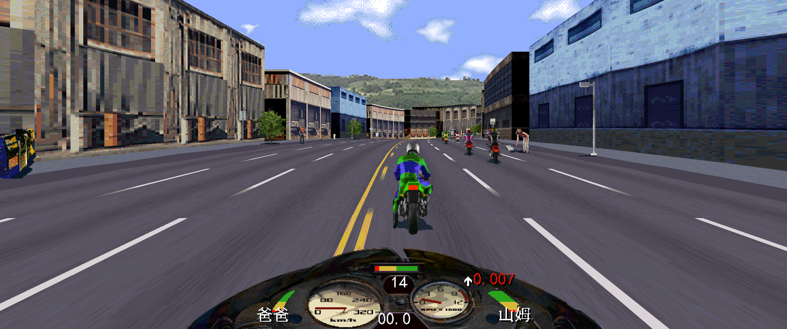
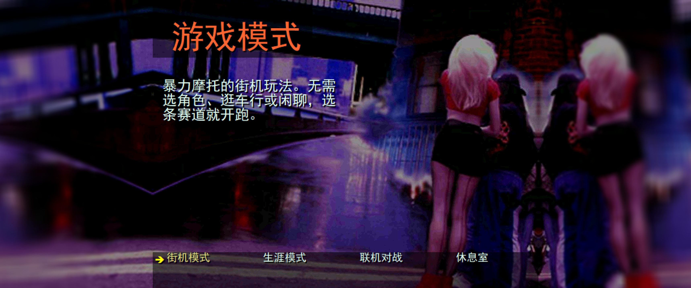
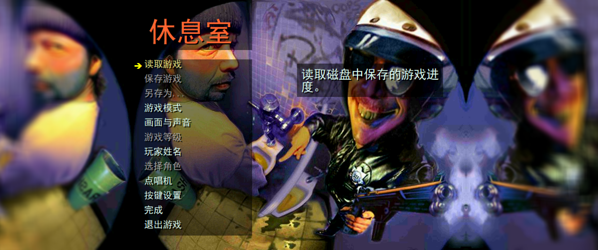
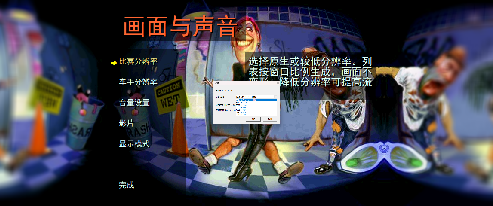

[中文](README.md) | [English](README.en.md)

# Road Rash: 30th Anniversary Edition — Automatic Native Resolution & HD Rendering Patch

For the Steam edition of **Road Rash: 30th Anniversary Edition**, build **26105967**. Automatically detects the current game-window resolution and redraws race scenes at that resolution instead of simply stretching the original image. Works with the English original and the separately localized Chinese edition.

**Chinese localization:** [RoadRash30th-Chinese](https://github.com/OBLPlife/RoadRash30th-Chinese)

## Install and Restore

**Install**

1. Exit the game. Download `RoadRash_HD_Setup.exe` from [Releases](https://github.com/OBLPlife/RoadRash30th-HD/releases/latest).
2. Place the EXE in the game folder, next to `RoadRash95.exe`.
3. **Double-click the EXE → choose Install.** Once installation finishes, launch the game through Steam.

**Resolution detection is automatic by default; no setup is needed.** To choose another internal rendering resolution, open **Graphics and Sound → Race Resolution** in the game.

**Restore**

Exit the game, double-click the same EXE, and choose **Restore** to restore the pre-installation executable and HD module. No PowerShell commands are required.

The installer backs up the files it changes and leaves save files and translations untouched. When using the separate Chinese localization, **install the localization first, then the HD patch; restore in reverse order**.

## In-Game Screenshots

**High-resolution gameplay**



| Game Mode Menu | Restroom Menu |
| :---: | :---: |
|  |  |

**In-game resolution settings (3440 × 1440)**

| Resolution List | Selected Resolution |
| :---: | :---: |
|  |  |

## Features

- **Automatic resolution detection:** Reads the current game-window size and updates rendering dimensions and mappings when it changes.
- **Native-resolution redraw:** Renders tracks, roads, scene geometry and textured objects at the target resolution rather than upscaling the original 640×480 race image.
- **Aspect-ratio adaptation:** Adjusts camera view and clipping for the current aspect ratio, including common 4:3, 16:9 and 21:9 displays.
- **In-game resolution selection:** Use automatic native resolution or a lower internal rendering resolution; settings are saved.
- **Menu and rendering fixes:** Keeps menu artwork centered at the correct proportions, extends the surrounding background, and improves distant details, flicker and road seams.

## Configuration (Optional)

The default `RoadRashHD.ini` needs no manual changes:

```ini
[Graphics]
Enabled=1
RenderHeight=0
```

`RenderHeight=0` follows the current game-window dimensions. A positive number sets an internal rendering height, with width calculated from the window's aspect ratio. Existing settings are preserved on installation.

## Build from Source

Requires Windows, Python 3.10+, Visual Studio C++ Desktop Development tools and Windows SDK, plus a .NET Framework 4.x compiler.

```powershell
python build.py
```

The installer is generated at `dist/RoadRash_HD_Setup.exe`. To build and run the related tests:

```powershell
python build.py --tests
python tests/test_installer.py --original-dir "D:\Games\RoadRashOriginal"
```

The rendering implementation is in `src/`; installation and restoration are in `Installer.cs`, `PatchWindow.cs` and `RendererPatch.cs`; tests are in `tests/`. The build does not package the original game.

## License

This project uses the [PolyForm Noncommercial License 1.0.0](LICENSE). Noncommercial use, modification and redistribution are permitted; **unauthorized commercial use or resale is prohibited**.
