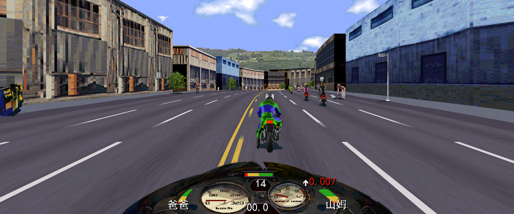
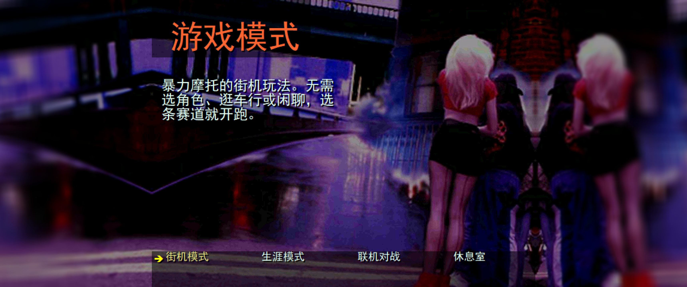
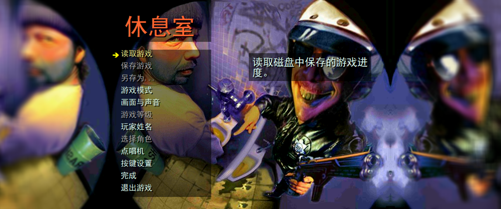
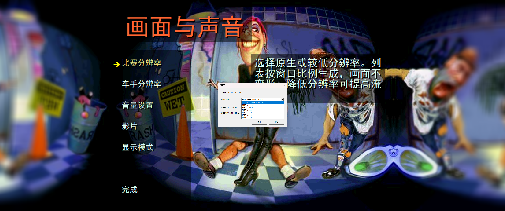

[中文](README.md) | [English](README.en.md)

# 暴力摩托：30周年纪念版｜原生分辨率与高清重绘补丁

适用于 Steam《暴力摩托：30周年纪念版》**build 26105967**，支持英文原版及独立中文汉化版。

**汉化补丁请移步：** [RoadRash30th-Chinese](https://github.com/OBLPlife/RoadRash30th-Chinese)

## 安装与还原

1. 从 [Releases](https://github.com/OBLPlife/RoadRash30th-HD/releases/latest) 下载 `RoadRash_HD_Setup.exe`，放到游戏根目录（与 `RoadRash95.exe` 同级）。
2. 双击 EXE，点击 **「安装」**。
3. 从 Steam 启动游戏。默认自动适配当前分辨率；可在「画面与声音 → 比赛分辨率」中调整。

还原时再次双击 EXE，点击 **「还原」**。

同时使用汉化补丁时，**先安装汉化，再安装高清补丁；还原顺序相反**。安装器自动备份原文件。

## 实机截图

**高清比赛画面**



| 游戏模式菜单 | 休息室菜单 |
| :---: | :---: |
|  |  |

**游戏内分辨率设置（3440 × 1440）**

| 分辨率列表 | 已选择的分辨率 |
| :---: | :---: |
|  |  |

## 功能

- **自动分辨率适配**：检测游戏窗口尺寸，按实际像素重新绘制比赛场景。
- **原生高清重绘**：重新光栅化道路、场景几何及纹理物体。
- **多种画面比例**：动态调整视野、投影和裁剪，适配普通屏、宽屏和超宽屏等比例。
- **游戏内分辨率选择**：自动原生模式或自选内部渲染分辨率，设置自动保存。
- **菜单与渲染优化**：菜单原画等比居中、背景延展，改善闪烁、远景缺失及道路接缝。

### v1.1.1 动画崩溃修复

修复半岛赛道崩溃。半岛赛道的崩溃与动画元数据缺失有关。**原版动画帧选择函数在相同异常输入下也会崩溃**；新版通过检查动画资源类型并跳过无效帧处理此问题，新增相应回归测试。

## 配置（可选）

`RoadRashHD.ini`：

```ini
[Graphics]
Enabled=1
RenderHeight=0
```

`RenderHeight=0` 为自动原生分辨率；正数为内部渲染高度，宽度按当前画面比例计算。

## 从源码构建

环境：Windows、Python 3.10+、Visual Studio C++ 桌面开发工具、Windows SDK、.NET Framework 4.x 编译器。

```powershell
python build.py
```

编译并运行测试：

```powershell
python build.py --tests
python tests/test_installer.py --original-dir "D:\Games\RoadRashOriginal"
```

渲染源码位于 `src/`，安装器位于 `Installer.cs`、`PatchWindow.cs` 和 `RendererPatch.cs`，测试位于 `tests/`。

## 许可证

本项目采用 [PolyForm Noncommercial License 1.0.0](LICENSE)，允许非商业使用、修改和分发；**禁止未经授权的商业使用及收费倒卖**。
